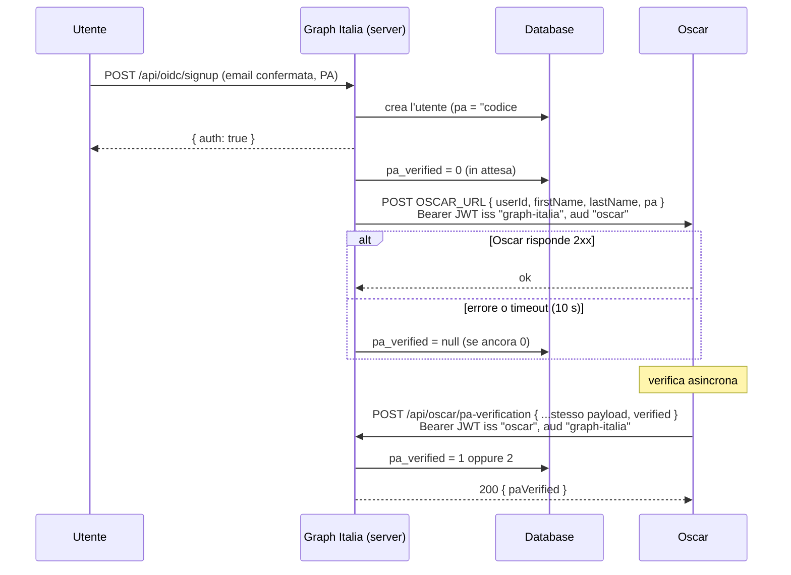

# Verifica dell'appartenenza alla PA con Oscar

Alla registrazione l'utente indica la pubblica amministrazione di appartenenza, scelta da IndicePA. Se la verifica è attiva, il server chiede al servizio Oscar di confermare che la persona lavori davvero per quell'ente. L'esito è solo un'informazione per gli admin: **non blocca né concede l'accesso**.

Il codice è in [`packages/server/lib/oscar.ts`](packages/server/lib/oscar.ts) (richiesta verso Oscar) e [`packages/server/routes/oscar.ts`](packages/server/routes/oscar.ts) (callback). I test sono in [`packages/server/tests/oscar.test.ts`](packages/server/tests/oscar.test.ts).

## Quando parte una richiesta

Solo quando un account viene **creato** con SPID/CIE (`POST /api/oidc/signup`) e la PA scelta ha un codice IPA. Non partono richieste:

- quando un accesso SPID/CIE si collega a un account già esistente;
- per le registrazioni con email e password;
- per gli account più vecchi, che hanno la PA salvata come solo nome, senza codice.

La richiesta parte in background: la registrazione non aspetta Oscar e non fallisce se Oscar non risponde.

## Il flusso



`pa_verified` passa a «in attesa» prima dell'invio: così un esito che arriva subito non viene sovrascritto.

## Richiesta verso Oscar

`POST {OSCAR_URL}`, oggi `https://oscar.developers.italia.it/api/graph-italia/pa-membership`.

```json
{
  "userId": "cmwc6jigb0000bail7qompcax",
  "firstName": "Mario",
  "lastName": "Rossi",
  "pa": { "code": "c_a944", "name": "Comune di Bologna" }
}
```

- `firstName` e `lastName` arrivano dalla sessione SPID/CIE (`given_name`, `family_name`) e **non vengono salvati** da Graph Italia.
- `pa.code` è il codice IPA e `pa.name` la denominazione ufficiale da IndicePA.
- Qualsiasi risposta 2xx è considerata un invio riuscito; il corpo della risposta non viene letto.

## Callback da Oscar

`POST {GRAPH_ITALIA_URL}/api/oscar/pa-verification`, in produzione `https://graph.developers.italia.it/api/oscar/pa-verification`. Il corpo è il payload ricevuto più `verified`:

```json
{
  "userId": "cmwc6jigb0000bail7qompcax",
  "firstName": "Mario",
  "lastName": "Rossi",
  "pa": { "code": "c_a944", "name": "Comune di Bologna" },
  "verified": true
}
```

| Risposta | Quando |
| --- | --- |
| `200 { "paVerified": 1 }` oppure `2` | Esito salvato (`verified: true` → 1, `false` → 2) |
| `400` | Payload non valido |
| `401` | Bearer assente, scaduto o firmato con un'altra chiave |
| `404` | Verifica disattivata su questa istanza (`ENABLE_OSCAR_PA_VERIFICATION` diverso da `"true"`), oppure utente inesistente |
| `409` | L'utente ha cambiato PA dopo la richiesta: `pa.code` non corrisponde più. Oscar non deve trattarlo come errore |

Un nuovo callback per lo stesso utente sovrascrive l'esito precedente.

## Autenticazione

In entrambi i versi c'è un header `Authorization: Bearer <JWT>`, con un JWT HS256 firmato con la stessa chiave condivisa e valido 5 minuti. La chiave non viaggia mai nelle richieste.

| Verso | `iss` | `aud` | Chiave |
| --- | --- | --- | --- |
| Graph Italia → Oscar | `graph-italia` | `oscar` | `OSCAR_KEY` da noi, `GRAPH_ITALIA_KEY` lato Oscar |
| Oscar → Graph Italia | `oscar` | `graph-italia` | stessa stringa |

La chiave va scambiata con il team di Oscar su un canale sicuro e mai committata. Se cambia, va aggiornata nello stesso momento sui due lati, altrimenti le chiamate ricevono 401.

## Stati di `pa_verified`

Colonna `pa_verified` della tabella `User` (campo Prisma `paVerified`), introdotta dalla migrazione `20261026120000_user_pa_verified`.

| Valore | Significato |
| --- | --- |
| `null` | Mai richiesta: verifica spenta, account precedente, PA senza codice, oppure invio a Oscar fallito |
| `0` | In attesa dell'esito |
| `1` | Appartiene alla PA |
| `2` | Non appartiene alla PA |

Gli admin vedono lo stato come badge nell'elenco utenti del pannello admin (`/private/god-mode-on`).

## Configurazione

| Variabile | Valore | Note |
| --- | --- | --- |
| `ENABLE_OSCAR_PA_VERIFICATION` | `"true"` | Qualsiasi altro valore la spegne; da spenta la callback risponde 404 |
| `OSCAR_URL` | `https://oscar.developers.italia.it/api/graph-italia/pa-membership` | |
| `OSCAR_KEY` | chiave condivisa | Secret. Se manca, con la verifica attiva, nei log compare un errore e non parte nessuna richiesta |

- **In locale**: in `packages/server/.env` (vedi `sample.env`).
- **In produzione e in test**: variabili `ENABLE_OSCAR_PA_VERIFICATION` e `OSCAR_URL` e secret `OSCAR_KEY` nell'Environment GitHub (`production` / `test`). Il workflow di release le passa a Helm con `--set-string` solo se valorizzate e **solo al deploy di un tag**: dopo averle impostate serve una nuova release, o rilanciare il deploy dell'ultima, perché arrivino ai pod.
- A Oscar va comunicato `GRAPH_ITALIA_URL`, cioè l'URL base senza path: `https://graph.developers.italia.it` per la produzione.

## Provare l'integrazione

### Da locale il giro non si chiude

Oscar richiama sempre il `GRAPH_ITALIA_URL` configurato da lui, cioè la produzione, non il tuo localhost. Una registrazione SPID/CIE fatta in locale invia a Oscar una richiesta **reale**, ma l'esito arriva in produzione, dove l'utente non esiste (404). Le due direzioni si provano quindi separatamente.

### Richiesta verso Oscar: solo autenticazione

Queste prove non creano nessuna richiesta di verifica: Oscar deve rispondere 401 in entrambi i casi.

```bash
# senza token → 401 {"message":"bearer assente"}
curl -s -w ' %{http_code}\n' -X POST -H 'Content-Type: application/json' -d '{}' \
  https://oscar.developers.italia.it/api/graph-italia/pa-membership

# token firmato con una chiave sbagliata → 401 {"message":"firma JWT non valida"}
cd packages/server
TOKEN=$(bun -e 'import {signOscarRequestToken} from "./lib/oscar.ts"; console.log(signOscarRequestToken("not-the-real-key"))')
curl -s -w ' %{http_code}\n' -X POST -H 'Content-Type: application/json' -H "Authorization: Bearer $TOKEN" -d '{}' \
  https://oscar.developers.italia.it/api/graph-italia/pa-membership
```

Con la chiave vera e un payload completo Oscar avvia una verifica reale sulla PA indicata: va concordato con il team di Oscar.

### Callback: simulare Oscar contro il server locale

Con il server avviato (`bun run dev:server`) e `ENABLE_OSCAR_PA_VERIFICATION="true"` e `OSCAR_KEY` nel `.env`, serve un utente con PA in formato `codice#nome`, per esempio uno creato con il mock OIDC (`bun run mock-oidc-server.ts`). Si firma un token come farebbe Oscar e si invia l'esito:

```bash
cd packages/server
TOKEN=$(bun -e 'import {sign} from "jsonwebtoken"; console.log(sign({}, process.env.OSCAR_KEY, {algorithm:"HS256", issuer:"oscar", audience:"graph-italia", expiresIn:300}))')
curl -s -w ' %{http_code}\n' -X POST http://127.0.0.1:3003/api/oscar/pa-verification \
  -H 'Content-Type: application/json' -H "Authorization: Bearer $TOKEN" \
  -d '{"userId":"<id utente>","firstName":"Mario","lastName":"Rossi","pa":{"code":"c_a944","name":"Comune di Bologna"},"verified":true}'
```

Risultati attesi: 200 con `paVerified` 1 (o 2 con `verified: false`); 401 senza token o con un'altra chiave; 409 con un `pa.code` diverso da quello dell'utente; 404 con un `userId` inesistente.

### In produzione

1. Impostare le variabili e il secret nell'Environment `production` e fare il deploy.
2. Creare un account SPID/CIE nuovo: nel pannello admin lo stato deve passare a «in attesa» e poi all'esito.
3. Se resta `null`, l'invio è fallito: nei log del server cercare `Oscar PA verification request failed` (con lo status restituito da Oscar). Se resta «in attesa», Oscar non ha ancora richiamato, oppure la callback viene rifiutata: chiedere a Oscar lo status ricevuto (401 = chiave diversa, 404 = verifica spenta o utente sconosciuto).
